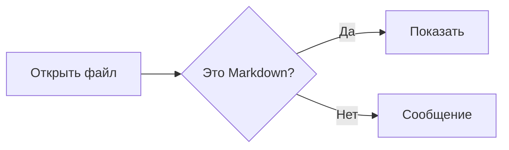
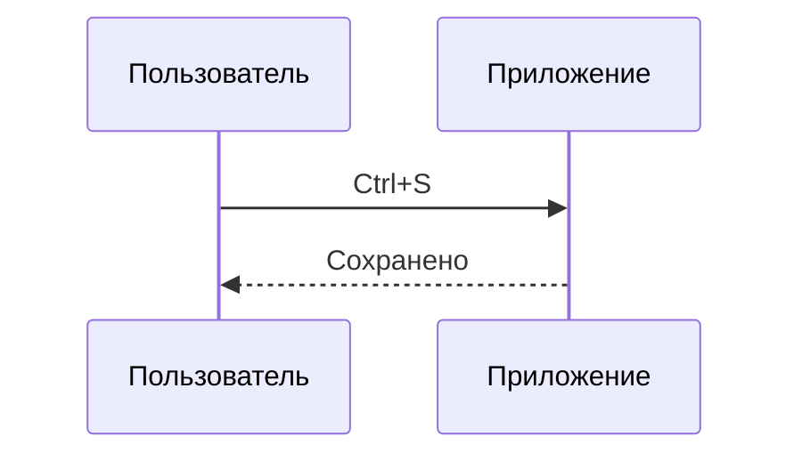
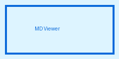

# Образец документа MD Viewer

Обычный абзац с **жирным**, *курсивом*, ~~зачёркнутым~~ и `кодом в строке`.
Автоссылка: https://github.com и ссылка на [раздел с таблицами](#таблицы).
Эмодзи по кодам: :smile: :rocket: :+1:

> Цитата: оформление в стиле GitHub.
> Вторая строка цитаты.

---

## Списки

- Первый пункт
- Второй пункт
  - Вложенный пункт
  - Ещё один
1. Нумерованный
2. Список

### Список задач

- [x] Сделано
- [ ] Не сделано

## Таблицы

| Слева | По центру | Справа |
| :---- | :-------: | -----: |
| яблоко | 1 | 10,5 |
| груша | 2 | 200 |
| слива | 3 | 3 000 |

## Код

```python
def greet(name: str) -> str:
    return f"Привет, {name}!"
```

```csharp
public static int Sum(int a, int b) => a + b;
```

```sql
SELECT id, name FROM users WHERE active = 1 ORDER BY name;
```

```json
{ "name": "MD Viewer", "version": 1 }
```

## Формулы

Строчная формула $E = mc^2$ и ещё одна $\sqrt{x^2 + y^2}$.

$$
\int_0^1 x^2 \, dx = \frac{1}{3}
$$

## Схемы





## Картинки



## Сноски

Текст со сноской[^1].

[^1]: Это сноска.

## HTML

<details>
<summary>Подробнее</summary>

Скрытый текст.

</details>

<p align="center">Абзац <b>HTML</b> по центру</p>
